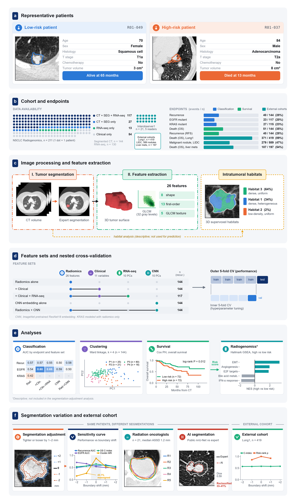
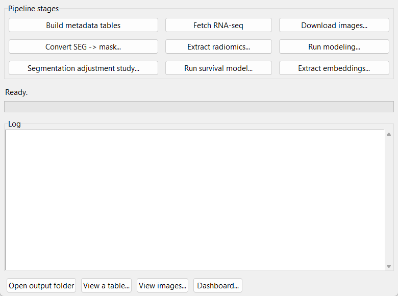
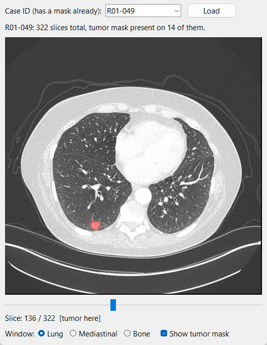
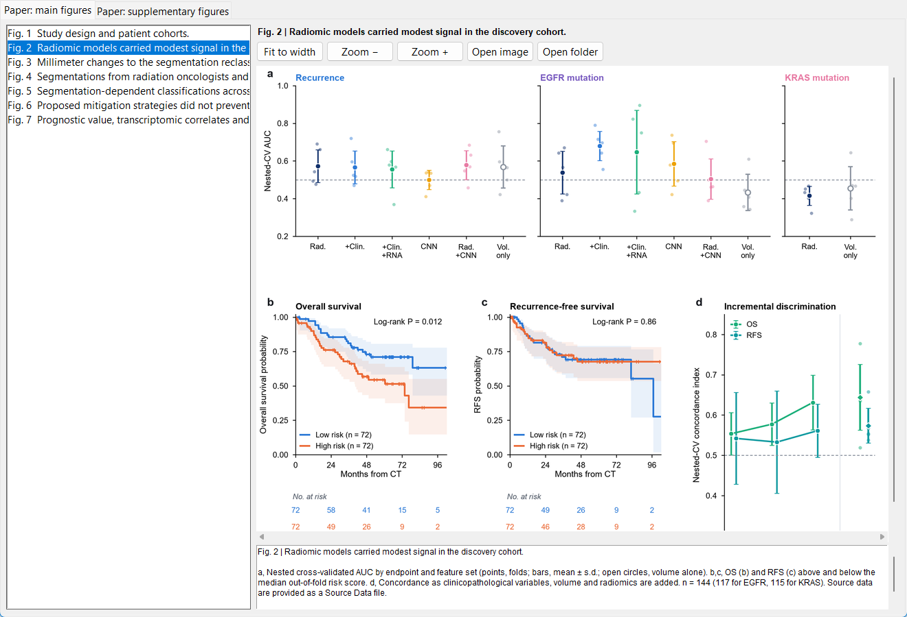
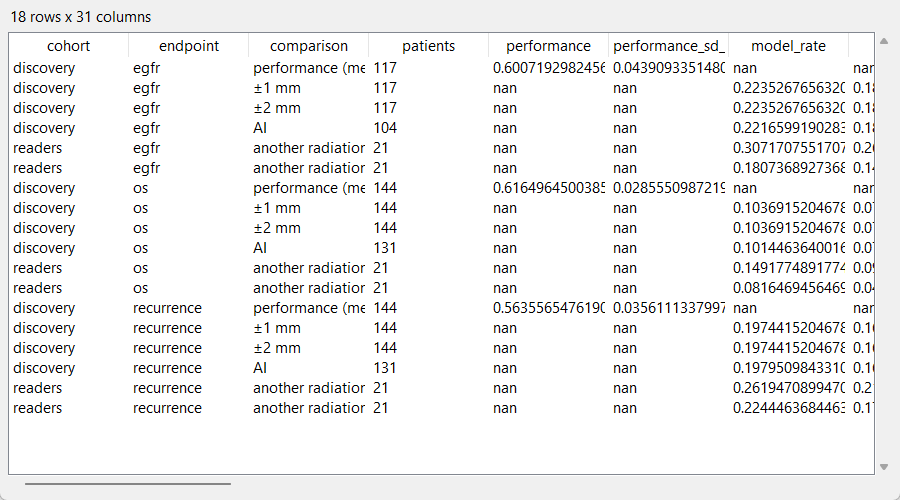

# Tumor segmentation induces individual-level instability in radiomic risk classification

Analysis code for the study. Radiomic models are usually developed on a tumor segmentation
drawn by one clinician. This project measures how often a different, equally reasonable
segmentation changes an individual patient's classification, and compares that with the
model's own development variability in the same patients. The segmentations compared are:

- the expert segmentation adjusted by ±1 and ±2 mm,
- segmentations by other radiation oncologists or radiologists,
- a public AI segmentation tool.

It also tests whether a per-patient check (re-scoring after a ±1-mm adjustment) adds
information beyond the distance of the score from the decision threshold, and evaluates
three mitigation strategies.

Five public cohorts are analyzed:

| Cohort | Collection | Role |
|---|---|---|
| Discovery (n = 144) | NSCLC Radiogenomics | Models, segmentation adjustment, AI segmentations, transcriptomics |
| Multi-reader NSCLC (n = 21) | NSCLC-Radiomics-Interobserver1 | Disagreement between five radiation oncologists |
| External cohort (n = 419) | NSCLC-Radiomics (Lung1) | Replication in a larger radiotherapy cohort; no-refit external validation of the OS model |
| Multi-reader nodules (589 nodules) | LIDC-IDRI | Do reader-dependent classifications disagree with the reader-consensus label? |
| Liver metastases (n = 197) | Colorectal-Liver-Metastases | Another organ; expert versus AI segmentations |

## Study overview



How the figure maps onto the code:

- **a | Representative patients.** A low-risk and a high-risk patient from the discovery
  cohort, with their CT, expert segmentation and outcome.
- **b | Cohort and endpoints.** The data available for each patient of the NSCLC Radiogenomics
  collection (CT, segmentation, RNA sequencing, clinical data), the external cohorts and the
  number of events per endpoint. *Produced by the `data` stage.*
- **c | Image processing and feature extraction.**
  - From each CT and its tumor segmentation, the code computes a fixed panel of 26 radiomic
    features: 8 shape, 13 first-order and 5 texture (GLCM) features.
  - Intratumoral habitats are computed for description only and are not used for prediction.
  - *Library:* `src/nsclc_pipeline/radiomics.py`. *Steps:* `discovery_features`, `habitats`.
- **d | Feature sets and nested cross-validation.**
  - Each endpoint is modeled with radiomics alone or with clinical variables, RNA sequencing
    or CNN image embeddings added.
  - The outer 5-fold loop measures performance; the inner 5-fold loop tunes the model, so
    tuning never sees the test patients.
  - *Library:* `src/nsclc_pipeline/modeling.py` and `survival.py`. *Step:* `baseline_models`.
- **e | Analyses.** Classification (recurrence, EGFR, KRAS), radiomic phenotypes, overall
  survival and gene-set enrichment of the survival risk score. *Produced by the `discovery`
  stage.*
- **f | Segmentation variation and external cohort.** Each patient is re-scored with a
  different but reasonable segmentation:
  - the expert segmentation made 1-2 mm tighter or looser (`segmentation_adjustment`,
    `adjusted_models`),
  - segmentations by five radiation oncologists (`readers` stage),
  - a public AI segmentation tool (`ai` stage).

  For each, the code counts how many patients change classification, and compares that with
  the model's own development variability measured in the same patients
  (`same_patient_comparison`). The analysis is replicated in the larger Lung1 cohort and
  extended to lung nodules and liver metastases (`external` stage).

## Repository layout

```
pipeline.py              the map of the project: every step, in order, with the paper items it feeds
pyproject.toml           installs the library (pip install -e .)
requirements.txt         pinned dependencies of the main environment (Python 3.12)
src/nsclc_pipeline/      library: data access, masks, features, segmentation adjustment, models, survival
scripts/                 one script per analysis step, grouped by topic (see scripts/README.md)
  data/                  downloads, masks and feature extraction for the discovery cohort
  discovery/             discovery-cohort models, segmentation adjustment, repeated validation, signal experiment
  survival/              Cox models, competing risks, incremental value, gene-set enrichment
  readers/               multi-reader NSCLC cohort (five radiation oncologists)
  ai_segmentation/       expert versus public AI (nnU-Net) segmentations
  mitigation/            stability filtering, averaging over segmentations
  external/              Lung1, LIDC-IDRI and liver-metastasis cohorts; threshold and rank checks
  pyradiomics/           IBSI-compliant reference features (separate Python 3.11 environment)
  figures/               every main and supplementary figure, with the shared figure style
  reporting/             runtime table
  gui/                   optional desktop viewer (Tkinter) for browsing data and results
data/
  raw/                   metadata files of the discovery collection
  processed/             processed results of every analysis step (versioned)
  external/              results of the external cohorts (versioned; images are not)
docs/                    data curation notes, the desktop viewer guide, and the README figures (docs/figures/)
outputs/                 figures written by the pipeline (created on first run; not versioned)
```

## Setup

```
pip install -r requirements.txt
pip install torch==2.14.0 torchvision==0.29.0 --index-url https://download.pytorch.org/whl/cpu
pip install -e .
```

Exact versions used for the paper: Python 3.12.10, pandas 2.3.3, NumPy 2.5.3, SciPy 1.18.1,
scikit-learn 1.9.1, SimpleITK 2.5.6, pydicom 2.4.5, scikit-survival 0.28.0, lifelines 0.30.3,
shap 0.52.0, gseapy 1.3.1, PyTorch 2.14.0, MONAI 1.6.1, scikit-image 0.26.0 and matplotlib 3.11.2.

The PyRadiomics steps (PyRadiomics 3.0.1) run in a separate Python 3.11 environment,
`.venv_pyradiomics`; see the end of `requirements.txt`. Downloads from the NCI Imaging Data
Commons use [s5cmd](https://github.com/peak/s5cmd). The foundation-model weights
(`fmcib.torch`; Pai et al., *Nat. Mach. Intell.* 2024) go in `models/`.

The LIDC-IDRI foundation-model features (`data/external/lidc/lidc_fm_features.csv`, 202 MB)
exceed GitHub's file size limit and are not included; the `lidc_data` step regenerates them.

## Reproducing the results

```
python pipeline.py list                  # every stage and step, with the paper items it feeds
python pipeline.py run all --dry-run     # print the full sequence of commands
python pipeline.py run <stage or step>   # run one stage (e.g. discovery) or one step (e.g. repeated_cv)
python pipeline.py run figures           # redraw all figures into outputs/figures/
```

The stages run in this order:

`data` → `discovery` → `readers` → `ai` → `external` → `pyradiomics` → `figures` → `reporting`

Steps tagged `[network]` download the public images (tens of GB in total) and take hours.
Steps tagged `[images]` read those CT images or segmentation masks; this includes the
figures, several of which show CT slices. All other steps run from the processed results
stored in `data/`, in minutes to about an hour each, so they can be rerun from a fresh clone
without any download. Random seeds are fixed throughout.

The header of each script gives the paper items it produces, its inputs and outputs, and the
pipeline step that runs it. `pipeline.py` logs the wall-clock time of every command to
`data/interim/runtime_log.csv`; `python pipeline.py run runtime_table` summarizes the log for
Supplementary Table S30.

Where the main results come from (see `python pipeline.py list` for every step):

| Paper item | Pipeline step(s) |
|---|---|
| Fig. 2; Suppl. Tables S2-S3 | `baseline_models`, `volume_only`, `radimagenet`, `bootstrap_ci` |
| Fig. 3; Table 3; Suppl. Tables S6-S8 | `adjusted_models`, `range_inference`, `repeated_cv`, `paired_segmentation_effect`, `fixed_vs_refit` |
| Fig. 3g, Fig. 5c; Suppl. Tables S9-S10 (same-patient comparison) | `same_patient_comparison`, `refit_bootstrap` |
| Suppl. Tables S11-S12 (threshold sensitivity, threshold-free shift) | `threshold_sensitivity`, `rank_shift` |
| Fig. 4; Suppl. Tables S13-S16, S18 | `interobserver`, `adjustment_vs_readers`, `reader_classifications`, `ai_models`, `ai_outcome`, `pyradiomics_*` |
| Fig. 5; Suppl. Tables S17, S19; Suppl. Fig. S9 | `lidc_models`, `crlm` |
| Fig. 6; Suppl. Tables S21-S22 | `stability_filtering`, `averaging` |
| Fig. 7; Suppl. Tables S23-S26 | `survival_tables`, `calibration_inference`, `radiogenomics`, `lung1_models` |
| Suppl. Fig. S10; Suppl. Table S20 (controlled-signal experiment) | `signal_experiment` |

## Desktop viewer (optional GUI)

A Tkinter desktop application is included for browsing the CT scans, segmentations, result
tables and figures without the command line. It calls the same library functions as the
pipeline. Start it from the repository root:

```
python scripts/gui/gui.py
```

The main window has buttons for the discovery-cohort steps (metadata tables, image download,
conversion of the expert DICOM-SEG segmentations to masks, feature and embedding extraction,
classification and survival models, and the segmentation adjustment study) and a log panel.
Long tasks run in the background, and feature extraction can be interrupted and resumed.



The image viewer shows the CT series on which a patient's segmentation was drawn, with the
expert segmentation overlaid in red, starting at the middle of the tumor. Lung, mediastinal and
bone windows are available, and the CT is downloaded the first time a patient is opened.



The dashboard browses the figures in `outputs/figures/` after `python pipeline.py run figures`.
If the environment variable `NSCLC_PAPER_DIR` points to a built manuscript, each figure is shown
with its number, title and legend from the paper.



The table viewer opens any `.csv` or `.csv.gz` file in `data/processed/` as a sortable table;
the screenshot shows the same-patient comparison of segmentation-induced and model-development
reclassification.



The full guide to every button, dialog and option is in [docs/data_and_gui.md](docs/data_and_gui.md).

## Terms used in file and column names

Some result files and columns keep the names they had when the analyses were first run, so
that existing outputs stay valid:

| In file or column names | Meaning in the paper |
|---|---|
| `perturb`, `perturbation`, `shift`, `m1mm` / `p1mm` | segmentation adjusted inwards / outwards by 1 mm |
| `bamf`, `ai` | the public AI (AIMI nnU-Net) segmentation |
| `flip`, `flips`, `decision_flip_rate` | reclassification (a change in a patient's classification) |
| `refit_noise`, `model_rate` | model-development variability |
| `swing`, `range` | range of a performance measure across segmentations |
| `outline` | segmentation |

## Data

All cohorts are public, from The Cancer Imaging Archive and the NCI Imaging Data Commons:

- NSCLC Radiogenomics, doi:10.7937/K9/TCIA.2017.7hs46erv
- NSCLC-Radiomics-Interobserver1, doi:10.7937/tcia.2019.cwvlpd26
- NSCLC-Radiomics, doi:10.7937/K9/TCIA.2015.PF0M9REI
- LIDC-IDRI, doi:10.7937/K9/TCIA.2015.LO9QL9SX
- Colorectal-Liver-Metastases, doi:10.7937/QXK2-QG03
- AIMI nnU-Net segmentations, doi:10.5281/zenodo.8345959

The RNA sequencing data are from GEO (GSE103584). Each collection is subject to its own
license. Curation details and known data caveats are described in
[docs/data_and_gui.md](docs/data_and_gui.md).

## License and citation

The code is released under the MIT License (see `LICENSE`). If you use it, please cite the
paper (see `CITATION.cff`).
